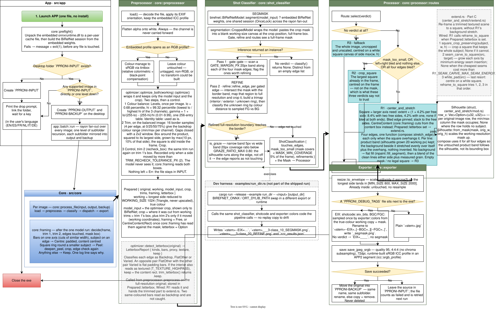

# Diagrams

[Up: docs home](../TOC.md)

WYSIWYG diagrams for Pproni, edited as draw.io (diagrams.net) files — free, no account,
no server.

* [JBA2B.drawio.svg](JBA2B.drawio.svg) — the end-to-end App/Core flowchart, the only diagram. What
  each container says and the maintenance rule: [architecture: the diagram](../architecture/06-diagram.md).
* [drawio-files.md](drawio-files.md) — setup, creating, editing, grouping, naming, asking Claude.
* [run-dir-tag-protocol.md](run-dir-tag-protocol.md) — tagging a diagram Rectangle and naming its
  debug image.

